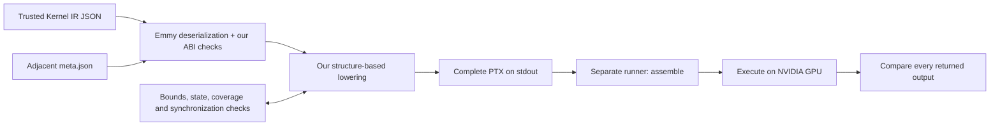
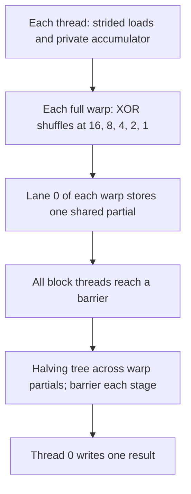
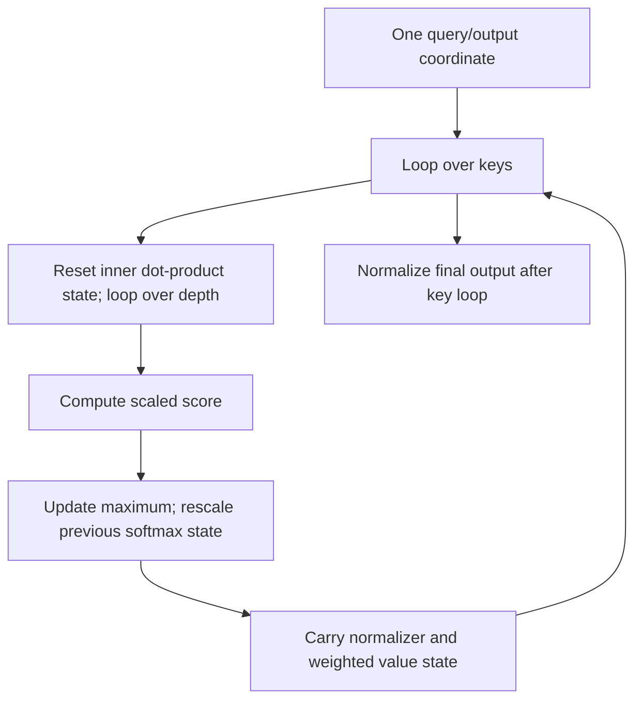

# Inside Emmy: an engineer's learning path

Start with the [offline interactive field guide](explainer/index.html). Download
or clone this repository, then open that file in a browser. GitHub's file viewer
shows its source rather than running it. No server or installation is needed to
use the page. Its inputs, styles, scripts and measurement data are embedded.

This guide assumes familiarity with functions, arrays, APIs and tests. It adds
GPU vocabulary only when it explains a concrete implementation decision. The
[detailed architecture](ARCHITECTURE.md), [reduction contract](REDUCTIONS.md),
[advanced schedules](ADVANCED_IR.md) and [numerical semantics](NUMERICS.md) remain
the references for exact support boundaries.

## 1. What is this compiler responsible for?

A normal API needs agreement on field names and types. A GPU kernel needs that
agreement too, plus an exact pointer order and a launch shape. Emmy's Kernel IR
already describes a scheduled computation: loads, arithmetic, stores, loops,
thread mappings and sometimes synchronization. This project translates supported
scheduled IR into PTX. It does not discover a new algorithm for every input or
call another compiler to do its lowering.

PTX is NVIDIA's virtual instruction set. It is text describing registers,
addresses, instructions and control flow; it is not yet the native GPU machine
code. A separate runner assembles it, launches a kernel, retrieves output arrays
and compares them with an oracle.



The arrows separate responsibilities. Analysis and validation also happen during
emission. The CLI buffers the whole result; a failed check produces a diagnostic
on stderr and a nonzero exit, with no partial PTX on stdout.

Read these entry points in order:

| Responsibility | Code to inspect | Why it matters |
| --- | --- | --- |
| Command contract | [compile.py:8](../compile.py#L8) | Parses one input path and separates PTX from diagnostics. |
| Composition | [compile_file](../emmy_ptx/__init__.py#L6) | Connects loading to our emitter, with no external lowering backend. |
| Typed graph and ABI | [load_kernel](../emmy_ptx/loader.py#L45) | Matches IR buffers to ordered metadata descriptors and launch geometry. |
| Backend selection | [emit](../emmy_ptx/ptx.py#L272) | Examines node structure, not benchmark names. |
| Shared scalar operations | [emit_math](../emmy_ptx/ptx.py#L80) | Gives every backend the same arithmetic implementation. |

The loader uses Emmy's required `Graph.from_dict`. Its representation includes
Python expressions evaluated by that deserializer. This accepts trusted official
or self-generated IR; it is not a sandbox for hostile uploads.

## 2. Follow ten additions

The field guide's [sample IR](explainer/sample/learn_add.ir.json) is an original
program built from Emmy's typed nodes. Its readable shape is:

```text
Tile i in [0, 10)
  a = Load left[i]
  b = Load right[i]
  c = Assign add(a, b)
  Write result[i] = c
```

This is a readable summary, not a replacement serialization format. The JSON
stores the full typed body's representation. The neighboring
[metadata](explainer/sample/meta.json) supplies `arg_order = [left, right, result]`,
three f32 buffers of length 10, grid `[2,1,1]`, and block `[8,1,1]`.

Reproduce the displayed PTX with the documented virtual environment:

```sh
.venv/bin/python compile.py docs/explainer/sample/learn_add.ir.json > /tmp/learn_add.ptx
cmp /tmp/learn_add.ptx docs/explainer/sample/learn_add.ptx
```

A **thread** executes one instance of the kernel. A **block**, also called a CTA,
is a group of threads that can cooperate through shared memory and barriers.
A **warp** contains 32 lanes that participate in warp-level instructions. This
simple pointwise sample uses eight threads per block and no cooperative warp
operation. The reduction backend has a different contract: complete warps are
required.

For this sample, every thread computes:

```text
i = block_index * block_width + thread_index
if i >= 10: return
result[i] = left[i] + right[i]
```

Block 1, thread 1 owns element 9. Block 1, threads 2–7 are idle. Their early guard
runs before memory access. An f32 occupies four bytes, so element 9 is at byte
offset 36 from each buffer pointer.

[Pointwise emission](../emmy_ptx/ptx.py#L238) builds that index and guard.
[Address emission](../emmy_ptx/ptx.py#L69) widens the byte offset to 64 bits.
[Statement lowering](../emmy_ptx/ptx.py#L206) assigns registers, emits loads and
`add.rn.f32`, then stores the result. Here `rn` means nearest-even rounding.
A separate coverage condition requires the valid writes to cover the output once.
The six idle threads are safe because they own no output cell.

A name in the IR is a value binding, not a physical GPU register number. The
emitter allocates PTX register names. PTX assembly later maps virtual resources to
the hardware. The page highlights the actual generated instructions and gives
their hash; clicking Next is an explanation step, not kernel execution.

## 3. Reduction: parallel work needs a rendezvous

Adding two arrays needs independent threads. Summing an array requires threads
to exchange partial results. For a supported scalar or row reduction, one block
owns the result and thread `t` processes `t, t+B, t+2B, ...`, where `B` is the block
width. A thread with no valid input keeps the operation's identity and still
participates in communication.



For example, 128 threads summing 130 values leave most threads with one load and
the first two with two loads. Four warps create four shared partials. All lanes
join the shuffle and block barriers, including lanes that had fewer loads.
Returning an idle lane early would violate that cooperative schedule.

[validate_reduction](../emmy_ptx/reduction.py#L93) recognizes and checks this
specific topology. [ReductionEmitter.run](../emmy_ptx/reduction.py#L199) emits the
private loop, shuffles, shared tree and final store. It reuses common arithmetic
for transformed sums, such as summing `x*x`, rather than adding a handler for each
problem name. Row reductions add a row offset and assign one block to each row.

Identity values follow the pinned Emmy operation. Sum uses zero; product uses
one. Maximum uses **-1e30**, not negative infinity. That finite identity is a
real limitation for some extreme input domains. Floating-point reassociation
also means a parallel sum need not have the same bits as a serial sum. The
[tests and numerical contract](REDUCTIONS.md) specify the accepted scope.

## 4. Matmul: moving data is part of the program

A matrix product reuses input values. Keeping tiles in a block's shared memory
reduces repeated global loads, but introduces visibility and lifetime rules.
The input IR already contains the copy and pipeline schedule. This compiler
validates and translates it; it is not a tensor-core autotuner.


The [copy validator](../emmy_ptx/matmul.py#L234) checks size, alignment and bounds.
The [statement dispatcher](../emmy_ptx/matmul.py#L380) enforces commit/wait/barrier
ordering before shared reads. A wait for asynchronous copies and a block barrier
serve different purposes; one does not replace the other.

The public rectangular schedule uses split-K: multiple blocks contribute partial
sums to the same output via atomic adds. Metadata must require the host to zero
that output **before** launch. A block cannot clear the output while another block
is adding to it. The square schedule uses one dynamic shared-memory pool whose
layout must match metadata. A real earlier assembler failure exposed the rule
that its external shared declaration belongs at module scope, not inside the PTX
entry. Both the failure and corrected pass remain in the saved results.

These checks cover supported schedules, not every possible asynchronous program.
Conditional shared-memory schedules and arbitrary races are outside the current
contract. See [shared-memory lowering](ADVANCED_IR.md#shared-memory-contractions).

## 5. Attention: state must live at the right loop level

Attention combines dot products, softmax and weighted values. The supported
structured schedules carry online softmax state across keys: a running maximum,
a normalizer and weighted output state. When the maximum changes, the previous
state must be rescaled. This avoids treating independent partial normalizers as
if they were already compatible.



The important compiler problem is state lifetime. The inner dot product resets
for each key. Outer softmax accumulators survive that inner loop.
[loop_accumulators](../emmy_ptx/structured.py#L318) and
[loop](../emmy_ptx/structured.py#L389) identify and initialize the right states.
`Accum.base` can replace a prior accumulator operand with its rescaled value.

[Condition handling](../emmy_ptx/structured.py#L367) gives each branch its own
value scope while allowing updates to existing carried state. Integer guards
refine bounds before memory access. [Output coverage](../emmy_ptx/structured.py#L560)
follows those guards too: an in-bounds read alone does not prove that every output
is written once. Ordinary output proofs are explicitly bounded to one million
logical Tile cells/output elements and four million traversal statements.

## 6. Why the exp change matters

The old exp sequence multiplied by rounded f32 `log2(e)` and fed that rounded
large exponent to `ex2.approx.f32`. A synthetic GPU sweep of 4097 values across
[-80,80] found **251 values outside its original tolerance**. A CPU model also
failed, demonstrating that exponent-scaling rounding contributed to the problem;
it did not identify every part of the hardware approximation error.

[The shared exp lowering](../emmy_ptx/ptx.py#L94) now writes
`x ≈ n*ln(2) + r`, retains a small residual using split high/low ln(2) constants,
and uses two scale factors to avoid premature underflow or overflow. Arithmetic
operations retain explicit f32 rounding and multiplication order. The two scale
exp2 operations are still approximate under the PTX contract.

The field guide plots **saved GPU outputs**, not the CPU model, and offers two
views. Relative error shows precision; error divided by the allowed error shows
whether the unchanged absolute-plus-relative threshold accepts a value. Its
range-reduction table is separately labeled as a CPU illustration. The fixed GPU
sweep had zero failures; maximum relative error changed from about 3.619 ppm to
0.153 ppm. These are sampled accuracy results, not a universal error bound or a
speed benchmark. [The full investigation](EXP_ACCURACY_FIX.md) preserves source,
PTX, oracle and output hashes.

## 7. Read evidence at the right level

| Evidence | What it establishes | What it does not establish |
| --- | --- | --- |
| Parser/ABI and rejection tests | Supported inputs are checked; known invalid contracts fail clearly. | Safety for hostile IR or acceptance of all legal Emmy graphs. |
| PTX CPU models | Operand flow, selected f32 semantics, addresses, state and modeled rendezvous. | PTX assembly, every GPU memory ordering rule, or hardware exp2 error. |
| Official runner receipts | A particular PTX artifact assembled, executed and matched complete expected arrays at recorded tolerances. | All hidden inputs, exceptional values or stable performance. |
| Same PTX hash | The emitted artifact matches one with saved evidence. | A new independent GPU execution. |
| CPU CI | Repeatable installation, fixture integrity, complete local suite and clean CLI output on Linux. | Any new GPU result. |

All 15 public artifacts have assembly/execution/comparison evidence; eight are
basic pointwise/reduction problems. The exp fix had 14 fresh GPU checks, including
three changed public artifacts and eleven synthetic checks. Current teaching
samples add no GPU claims. The documented pre-documentation CI baseline is 240
local tests; later totals should be read from the exact commit's Actions run.

Known limits include positive static f32 shapes, one-dimensional launch geometry,
unsupported IR/schedules, finite maximum identities, approximate math, atomic
subnormal behavior and the unresolved upstream ReLU NaN contract conflict.
The first Linux CI run also caught a test oracle that assumed NumPy's signed-zero
bits were portable. Its correction preserved explicit PTX zero-sign checks and
all official tolerances. [CI evidence](CI.md) records both failure and correction.

Continue with [submission readiness](SUBMISSION_READINESS.md) and the
[own-voice video outline](WALKTHROUGH.md). The video should explain what you
understand and can demonstrate, using your own words and voice.
