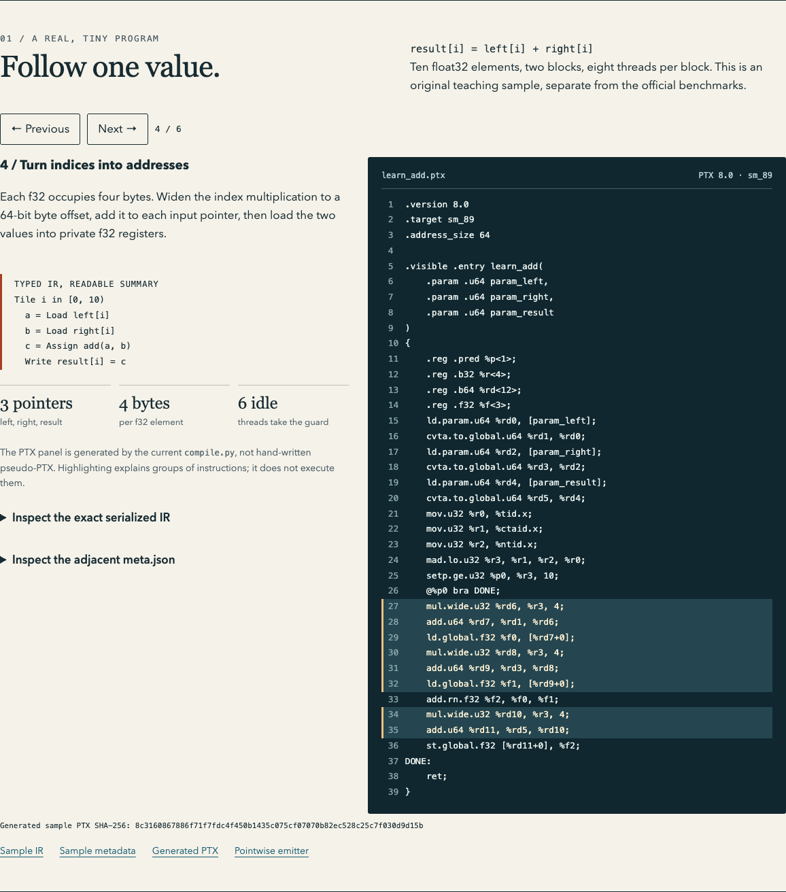
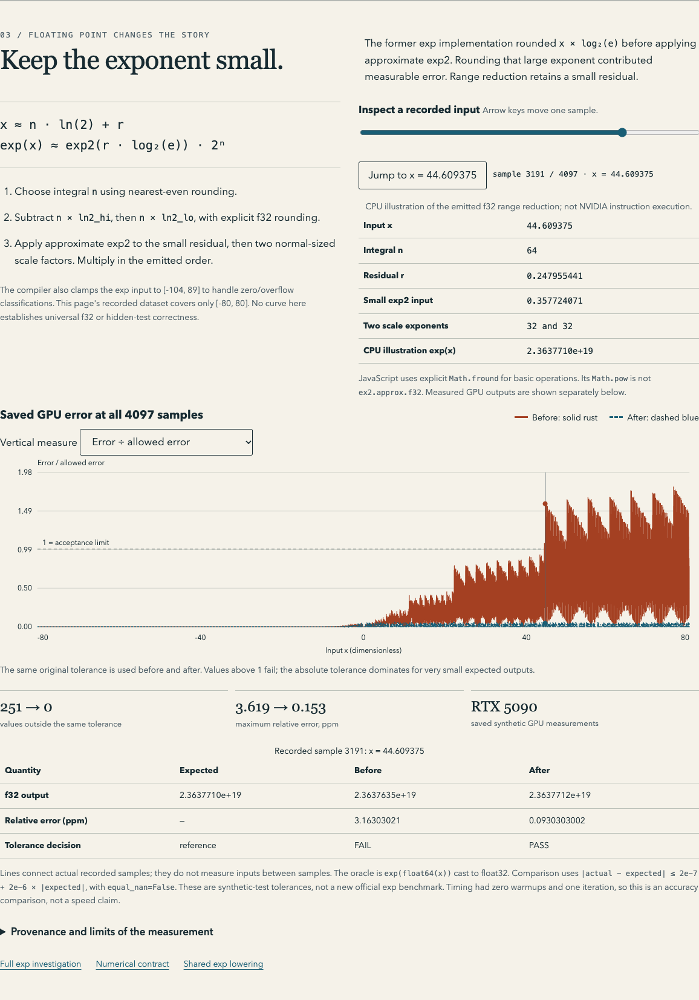
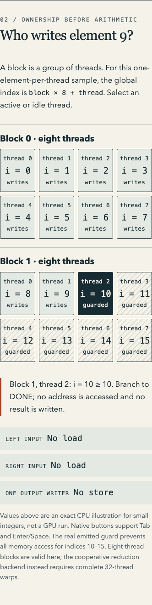

# Learning material validation

The documentation and offline page explain the compiler at source baseline
`cc4c27c5156e71acf95b6ae9a27af561c6428f3c`. No compiler algorithm, tolerance,
dependency or GPU result was changed for this learning material.

## Reproducible examples and measured data

- The ten-element teaching graph is constructed from typed Emmy nodes and compiled
  by this project's `compile_file`. Its serialized IR, ordered metadata and exact
  PTX are checked in under [explainer/sample](explainer/sample/learn_add.ir.json).
  A CPU-model regression checks all ten results and the six unused launch lanes.
- The exp plot contains every saved output from the existing 4097-point synthetic
  sweep, before and after the fix. Both saved oracles agree. The builder verifies
  output, oracle and PTX hashes against the saved receipts and reproduces **251
  failures before, zero after**, using the original comparison thresholds.
- The browser's range-reduction table is a CPU illustration. It is separate from
  the recorded GPU output table and does not emulate NVIDIA's approximate exp2.
- [provenance.json](explainer/provenance.json) records production source and input
  evidence hashes. No official reference arrays are redistributed by this page.

## Browser verification, 2026-10-25 UTC

An isolated session used the already installed Playwright CLI 0.1.21 and Chrome
156. No package or browser was installed. Only this project's temporary loopback
server and test session were used; no shared account tabs were opened.

The reproducible [callback](explainer/browser-check.js) and its sanitized
[result](explainer/validation/browser-results.json) record:

| Check | Result |
| --- | --- |
| Six IR/PTX stages, real-instruction highlights, boundary buttons | PASS |
| Keyboard navigation and active/idle thread selection | PASS |
| Slider endpoints, arrow key, witness input and both chart measures | PASS |
| All 4097 measured rows and recomputed 251/0 failures | PASS |
| Viewport widths 1440, 768, 360 and 320 px | PASS; no page overflow |
| Reduced-motion setting | PASS |
| Interaction after network was disabled | PASS |
| Subresource/network requests and JavaScript errors | None beyond the local HTML request; no errors |

Commands and setup are documented in the [explainer README](explainer/README.md#browser-checks).
The automation harness rejects direct `file:` navigation, so testing used
loopback HTTP and then disabled networking. No bypass was attempted. The HTML
has no server dependencies; a direct-file launch, iOS preview, and a full screen
reader audit were not automated. A GitHub HTML code view is not an interactive
preview. Download the file to a browser that executes local HTML, or open the
repository copy locally. Screenshots remain readable without JavaScript.

## Screenshots

These are captures of the actual page, not design mockups. Their SHA-256 values
are in the browser result above.

### Actual generated PTX with highlighted address instructions



### Saved GPU measurements and the original acceptance threshold



### Thread mapping at a 360-pixel viewport



## Local and CI verification

The added checks are part of the existing complete CPU suite. Regeneration and
local link checks run without network access:

```sh
.venv/bin/python tools/build_explainer.py --check
.venv/bin/python tools/check_docs.py
.venv/bin/python tools/run_tests.py
.venv/bin/python tools/check_cli.py
```

On macOS with Python 3.12.12, the complete suite passed **243 tests in
145.868 seconds**, exit 0. Regeneration verified five artifacts; local link checks
passed for 18 Markdown documents and 264 links. All 15 official CLI emissions
matched their saved PTX hashes and both invalid-input CLI checks passed. The
[saved local result](explainer/validation/local-results.json) and
[complete test output](explainer/validation/local-tests.txt) preserve these checks.
The exact GitHub Actions run for this change is linked in the delivery report. This work makes no new GPU execution or performance
claim; the existing GPU records remain bound to their own PTX hashes.
